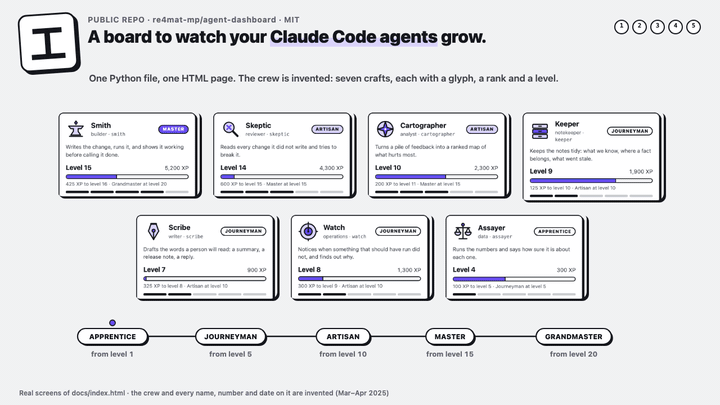

# You can watch your Claude Code agents grow, with one Python file and one HTML page.

A board for a crew of agents: who does what, who earned what, who handed work to whom, and a pop-up when
someone reaches a new rank.

[](https://re4mat-mp.github.io/agent-dashboard/)

**▶ [Open the board](https://re4mat-mp.github.io/agent-dashboard/)**: one rank-up is waiting for you the first time.

I work with a small crew of Claude Code agents, each with one craft: one builds, one tries to break what was built,
one keeps the notes, and so on. After a while I needed to *see* them: which ones I lean on, which ones are
growing, which ones pass work to each other. So I built a board. This repo is that board rebuilt small, with an
original theme and invented data, so every line can be read in one sitting. How I work with the agents themselves
is a different repo: [claude-setup-guide](https://github.com/re4mat-mp/claude-setup-guide). This one is only about
the board.

> **In three sentences.** Three plain files hold everything: who is on the crew, every XP award, every dispatch.
> One script computes the rest (levels, ranks, the Lead, hand-offs, rank-ups nobody has watched) and writes one
> self-contained HTML page. Nothing that can be computed is ever stored, and only one command can write XP.

## Try it in 10 minutes

You need Python 3.8 or newer and a browser. No packages, no server, no API key.

1. **Build the board.**

   ```bash
   git clone https://github.com/re4mat-mp/agent-dashboard && cd agent-dashboard
   python3 generate.py
   open docs/index.html          # Linux: xdg-open, Windows: start
   ```

   The Cartographer's rank-up plays first: it was crossed by the newest award, and nobody has watched it yet.
   Click **Got it** and reload: it doesn't come back.
2. **Give someone XP and watch the reveal.** The Skeptic is 600 XP away from Master.

   ```bash
   python3 generate.py --award Skeptic 650 "Found the bug the tests missed"
   ```

   The terminal says `RANK UP: Skeptic is now Master`. Reload the page: the pop-up plays, and the Lead moved
   too, because the Lead is the crew's average.
3. **Try to cheat.** `--award Lead 100 "x"`, `--award Nobody 5 "x"` and `--award Smith 5000 "x"` are all refused,
   and nothing is written.
4. **Run the tests.** `python3 tests/smoke_test.py` should end with `18 passed, 0 failed`.
5. **Make it yours.** Edit the table in [`crew/roster.md`](crew/roster.md) so each row is one of your agents
   (the `Agent` column is its `subagent_type`). Then clear the invented history and read your own:

   ```bash
   : > crew/award_log.jsonl                  # the invented awards name the invented crew
   echo '{}' > crew/reveals_seen.json
   python3 tools/read_transcripts.py         # what it found, writes nothing
   python3 tools/read_transcripts.py --write # replaces crew/activity.jsonl
   python3 generate.py
   ```

   Your crew starts at zero XP, with your real dispatch counts. Your task descriptions are never copied. The
   tests are written against the invented crew, so they stop applying once the roster is yours.

To start over, `git checkout crew/` and run `python3 generate.py` again. The pop-ups you've watched are
remembered by your browser; open the page in a private window to see them again.

## What's on the board

| Part | What it shows | Computed from |
|---|---|---|
| **The Lead** | Level, rank and XP of whoever sends the work. It never earns XP: it's the crew's average | every award |
| **Crew cards** | Each craft's glyph, rank, level, XP bar, rank pips, last three awards, how often it was dispatched | `award_log.jsonl`, `activity.jsonl` |
| **Hand-offs** | Pairs of crafts where one sent work straight to the other, and the latest six | `activity.jsonl` |
| **Rank-up pop-up** | One per rank crossed and not yet watched, oldest first, with the award that did it | the award log, replayed |
| **Text version** | The same board in plain HTML, for JavaScript off, for screen readers, and for an AI reading the page | the same data |

The theme is a workshop because I think of an agent as a craft, not a project. Seven crafts with a
glyph each: the Smith (builder), the Skeptic (reviewer), the Cartographer (analyst), the Keeper (notes), the
Scribe (writer), the Watch (operations) and the Assayer (data). Ranks go Apprentice, Journeyman, Artisan,
Master, Grandmaster.

---

<details>
<summary><b>1. Three files, and only one command writes XP</b></summary>

Everything the board knows lives in [`crew/`](crew/):

- [`roster.md`](crew/roster.md): who exists and what each one does. A markdown table, so it reads well on
  GitHub and a person can edit it. **No numbers in it.**
- [`award_log.jsonl`](crew/award_log.jsonl): one line per award, `{ts, name, xp, why}`. Append-only.
- [`activity.jsonl`](crew/activity.jsonl): one line per dispatch, `{ts, from, to, task}`.

A crew member's XP is the sum of their lines in the log. It is never typed into a table, so it can't drift from
the awards that justify it. Level and rank aren't stored either: they're computed every run. If a number can
be computed, storing it just gives it a chance to be wrong.

The only writer of XP is `--award`: `check_award` refuses an unknown name, the Lead, a number that isn't a whole
number from 1 to 1,000, or an empty reason (`generate.py:279`). Then `append_award` adds one line and never
touches the others (`generate.py:296`). A test reads `generate.py` itself and fails if any other function opens
the log or writes to it by name, or if `append_award` is called from a second place (`tests/smoke_test.py:101`).

Why a reason is required: an award with no *why* teaches nothing when you read the card a month later.

</details>

<details>
<summary><b>2. The curve: one formula, and its inverse in one line</b></summary>

Reaching level L costs `25 × (L − 1)²` XP in total (`generate.py:57`). Level 2 is 25 XP, level 10 is 2,025,
level 20 is 9,025: each level costs a bit more than the one before, so early levels come fast and late ones
mean something. The inverse is one line of integer math, `1 + isqrt(xp // 25)` (`generate.py:61`), so there is
no rounding to get wrong.

Ranks are bands of levels (`generate.py:65`): Apprentice from 1, Journeyman from 5, Artisan from 10, Master from
15, Grandmaster from 20. The test walks every XP value from 0 to 40,000 and checks the level never goes down and
always sits between its floor and the next one (`tests/smoke_test.py:120`).

To change the pace, change `XP_STEP` or the bands. Nothing else depends on the numbers.

</details>

<details>
<summary><b>3. The Lead is an average, never an award</b></summary>

The Lead is whoever sends the work: in Claude Code, the main session. It isn't a row in the roster and can't
be awarded. Its XP is the crew's total divided by the crew size, recomputed after every award
(`generate.py:157`), so it rises when the crew does and its own rank-ups are replayed the same way as anyone's.

Why an average and not a sum: a sum only grows when you add agents. An average grows only when the crew gets
better, and adding a new apprentice pulls it down, which is honest.

The test awards two crafts in a copy of the repo and checks the Lead against a sum it computes itself from the
log (`tests/smoke_test.py:135`).

</details>

<details>
<summary><b>4. Hand-offs: when one craft sends work to another</b></summary>

A dispatch from the Lead is ordinary work. A dispatch from a craft to another craft is a hand-off: the Smith
asking the Skeptic to review, the Cartographer handing the Smith a fix to build. The board counts the pairs,
most frequent first, and lists the latest six (`generate.py:196`).

**With real data, this strip stays empty.** A Claude Code transcript records that a sub-agent was sent, but
not which agent sent it: a dispatch from inside another agent's run only says "an agent". So
`tools/read_transcripts.py` writes every dispatch as from the Lead or from "(an agent)", and neither counts as a
hand-off between two named crafts. A useful stand-in is to treat two different agents dispatched back-to-back in one session, within
an hour, as a hand-off with the Lead carrying the work between them. If you do that, label it on the board as
inferred: it's a guess about what happened, not a record of it.

</details>

<details>
<summary><b>5. The reveal: two memories of what you've already watched</b></summary>

A rank-up is a moment, but the award and you opening the page are two different events. So the board doesn't
fire on "XP just changed". It replays the award log and records the first moment each rank was reached, with
the award that did it (`generate.py:130`). Every crossing that hasn't been watched is **pending**
(`generate.py:201`), and the page plays them one at a time, oldest first.

"Watched" has two memories, because the page is static and can't write files:

- [`crew/reveals_seen.json`](crew/reveals_seen.json), the CLI's. `python3 generate.py --seen` marks everything
  crossed so far as watched (`generate.py:302`). The repo ships with every crossing marked except one, so a
  first visit has exactly one reveal waiting.
- Your browser's `localStorage`, the page's (`dashboard.template.html:253`). **Got it** adds the crossing there,
  so a reload doesn't replay it.

**Replay last rank-up** on a card plays it again without touching either memory.

The pop-up's animation is CSS keyframes (`dashboard.template.html:112`), not a JavaScript loop. The only timer
on the page is a short pause between two queued pop-ups. A board can sit in a background tab or a window nobody
is looking at, and a browser is free to pause timers and animation loops there. An animation that
never ran reports no error, so it's easy to ship one that silently does nothing.

</details>

<details>
<summary><b>6. One template, two tokens, one self-contained page</b></summary>

[`dashboard.template.html`](dashboard.template.html) is the page with two holes. `generate.py` fills them
(`generate.py:261`) and writes [`docs/index.html`](docs/index.html), which GitHub Pages serves as-is:

- the **data token**, inside a `<script type="application/json">` tag, becomes the whole board as JSON. Any
  `</` in the data is written as `<\/`, so an award reason like `</script>` can't end the script early
  (`generate.py:265`). A test tries exactly that (`tests/smoke_test.py:271`).
- the **text-version token** becomes plain HTML written in Python, not JavaScript (`generate.py:225`), so it
  reads with JavaScript off. Each count carries a `data-count` attribute, and a test checks every one against
  the files (`tests/smoke_test.py:231`).

`generate.py` refuses to build if either token is missing or appears twice. `docs/index.html` is never edited
by hand: edit the template and run the script.

No CDN, no web fonts, no network. The glyphs are inline SVG drawn in the template
(`dashboard.template.html:168`), and a craft you add without a glyph gets a hexagon with its initial
(`dashboard.template.html:184`). The page carries the date of the newest entry in the data, never the clock,
so two builds on the same data are identical byte for byte, and a test checks that too.

</details>

<details>
<summary><b>7. Point it at your own crew</b></summary>

1. Rewrite the table in [`crew/roster.md`](crew/roster.md): one row per agent. `Agent` is the
   `subagent_type`, the name of its file in `~/.claude/agents/`.
2. Empty [`crew/award_log.jsonl`](crew/award_log.jsonl) and [`crew/reveals_seen.json`](crew/reveals_seen.json).
3. Run `python3 tools/read_transcripts.py`. Claude Code keeps every session as JSONL under `~/.claude/projects/`,
   and each time the session sends a sub-agent there's a `tool_use` block named `Agent` with a `subagent_type`
   in its input. The script counts those, matches them to your roster, and lists any agent with no row. With
   `--write` it replaces `crew/activity.jsonl`.
4. Award XP as work lands: `python3 generate.py --award <name> <xp> "<why>"`.

The reader keeps three fields per dispatch: when, whether the Lead or an agent sent it, and to whom. **The task description is never copied**,
because it often says more than you'd want in a public repo (`tools/read_transcripts.py:63`). A test feeds it a
fake transcript with a secret in the description and checks the secret doesn't come out
(`tests/smoke_test.py:310`).

What XP should pay for is your call. Mine pays for results: a bug caught, a fix shipped and seen working. Not
for effort, and not for the number of times an agent was sent.

</details>

<details>
<summary><b>8. The tests, and what each one guards</b></summary>

`python3 tests/smoke_test.py`, standard library only. Every check that runs the script runs it on a copy of the
repo in a temp folder, so your data is never touched.

| Check | Guards |
|---|---|
| a plain build writes nothing in `crew/` | only `--award` writes XP |
| an award appends exactly one line | the log is append-only |
| seven bad awards are refused and write nothing | the gate in front of the log |
| only one function opens the log for writing | nobody adds a second writer later |
| the curve is monotonic and exact | levels never go down, every XP maps to one level |
| the Lead is the average, after two awards | the Lead can't drift from the crew |
| a crossing is pending until `--seen` | the reveal fires once, for the right rank |
| pending rank-ups come oldest first | a new award doesn't jump the queue |
| the page only links to GitHub, the repo links nowhere else | the page stays self-contained |
| the guide is linked exactly once | this repo doesn't turn into the guide |
| the text version's counts match the files | the JS-off page tells the truth |
| two builds are identical, and the committed page is current | the page can't go stale |
| the template's tokens survive | an edit can't silently drop the data |
| a `</script>` in a reason can't break the page | data never becomes markup |
| the text version escapes the roster | a `<tag>` in a description stays text |
| the page's `esc()` replaces `& < > " '`, and every drawn field goes through it | the same, for the drawn board |
| the transcript reader keeps three fields | your descriptions stay on your machine |

A green test is only worth something if it can go red. Before trusting one, break the line it guards (make the
Lead divide by one more, or let a plain build append to the log) and watch it fail.

</details>

---

| File | What it is |
|---|---|
| [`generate.py`](generate.py) | Reads `crew/`, computes everything, writes `docs/index.html`. The only writer of XP |
| [`dashboard.template.html`](dashboard.template.html) | The page: styles, glyphs, cards, hand-offs, the pop-up |
| [`docs/index.html`](docs/index.html) | The generated page that GitHub Pages serves. Never edited by hand |
| [`crew/`](crew/) | The roster, the award log, the dispatches, the watched rank-ups. All invented |
| [`tools/read_transcripts.py`](tools/read_transcripts.py) | Optional: your real dispatches from your Claude Code history |
| [`tests/smoke_test.py`](tests/smoke_test.py) | 18 checks, standard library only |
| [`CUT.md`](CUT.md) | What this public version keeps from my own board, what it leaves out, and why |

MIT licensed. Take the mechanisms, change the theme, make it look like your crew.
